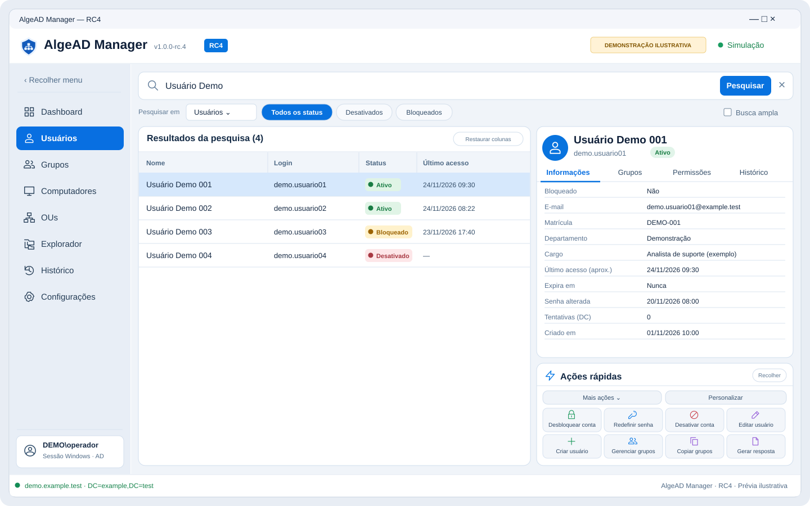

<h1>AlgeAD Manager</h1>

<strong>Active Directory. Uma experiência mais moderna.</strong>

Gerenciamento de usuários, grupos, computadores e unidades organizacionais em uma interface desktop em português.

 

[Visão geral](#visão-geral) · [Funcionalidades](#funcionalidades) · [Requisitos](#requisitos) · [Histórico de versões](https://github.com/rodrigoalgeri/AlgeADManager-Releases/releases) · [Suporte](#suporte)

---

## Conheça a interface

  
  
Prévia ilustrativa em modo claro, baseada na interface RC4. Todos os dados são fictícios; a aparência pode variar conforme a versão e as configurações.

## Visão geral

O **AlgeAD Manager** é uma alternativa desktop ao console Usuários e Computadores do Active Directory (ADUC), desenvolvida para simplificar tarefas frequentes de suporte técnico e infraestrutura.

A aplicação trabalha com o Active Directory existente da organização. Ela não substitui o serviço de diretório nem concede permissões administrativas adicionais. Sua interface reúne pesquisa, propriedades dos objetos e ações rápidas no mesmo ambiente.

> [!NOTE]
> O projeto está no canal **Release Candidate (RC)**. As versões públicas são destinadas à avaliação e homologação. Valide o aplicativo em ambiente autorizado antes de utilizá-lo em produção.

## Download

**Windows 10/11 · arquitetura x64**

| Pacote | Para quem é indicado | Download |
| :--- | :--- | :--- |
| **MSI completo** | Primeira instalação ou atualização da base | [**Baixar instalador completo**](https://github.com/rodrigoalgeri/AlgeADManager-Releases/releases/download/build-20261124.64/AlgeADManager-1.0.0-rc.4-20261124.64-x64.msi) |
| **MSI de atualização da interface** | Quem já possui a base compatível 20261124.64 | [Baixar atualização RC4 · Build 66](https://github.com/rodrigoalgeri/AlgeADManager-Releases/releases/download/build-20261124.66/AlgeADManager-1.0.0-rc.4-20261124.66-UI-from-20261124.64-x64.msi) |
| **Portable** | Quem prefere a edição sem instalação MSI | [Baixar versão Portable](https://github.com/rodrigoalgeri/AlgeADManager-Releases/releases/download/build-20261124.64/AlgeADManager-1.0.0-rc.4-20261124.64-Portable-x64.exe) |

Referência destes links: RC4, base 20261124.64 e atualização de interface 20261124.66. Consulte as releases para verificar versões posteriores.

> [!IMPORTANT]
> Se você ainda não possui o AlgeAD Manager, comece pelo **MSI completo**. Um pacote identificado como `UI-from` é uma atualização da interface e exige a base indicada no nome do arquivo. Um ZIP de atualização Portable também não é uma instalação completa.

[Consultar todas as versões e arquivos disponíveis](https://github.com/rodrigoalgeri/AlgeADManager-Releases/releases)

### Como instalar

1. Baixe o MSI completo para Windows x64.
2. Execute o instalador e siga o assistente, respeitando as políticas de segurança da sua organização.
3. Abra o AlgeAD Manager e, em **Configurações → Atualizações**, consulte as versões disponíveis.
4. Para experimentar os recursos sem conectar a um domínio real, utilize a homologação simulada.

## Funcionalidades

| Administração | Produtividade |
| :--- | :--- |
| **Usuários** — criação, edição, desbloqueio, redefinição de senha e ativação/desativação. | **Pesquisa** — nome, login, e-mail, matrícula e filtros de status. |
| **Grupos** — consulta de membros e gerenciamento de associações diretas. | **Ações rápidas** — operações frequentes acessíveis no painel do objeto. |
| **Computadores** — propriedades, organização e operações permitidas. | **Operações em lote** — fluxos de criação e gerenciamento, sujeitos à validação do AD. |
| **Unidades organizacionais (OUs)** — pesquisa, criação, movimentação e gerenciamento. | **Exportação e histórico** — informações de pesquisa, registros locais e auxílio aos chamados. |
| **Explorador do diretório** — navegação hierárquica por objetos e contêineres. | **Atualizações integradas** — consulta de novas versões e instalação mediante confirmação. |

As operações dependem das permissões da conta autenticada, das políticas do domínio e do tipo de objeto selecionado.

### Uma interface que se adapta ao seu trabalho

| Aparência | Organização |
| :--- | :--- |
| Modo claro, escuro ou automático | Menu lateral recolhível |
| Temas e cores de destaque | Painéis de informações e ações rápidas |
| Fontes, densidade e tamanho de ícones ajustáveis | Tabelas com colunas personalizáveis |
| Identidade visual única nos modos claro e escuro | Layout adaptável a diferentes larguras de janela |

### Experimente sem um domínio real

O ambiente de homologação simulada permite conhecer a interface e testar operações sobre dados fictícios. Ele não altera um Active Directory real e não substitui a validação em laboratório.

## Requisitos

- Windows 10 ou Windows 11, 64 bits.
- Microsoft Edge WebView2 Runtime — [download oficial da Microsoft](https://developer.microsoft.com/microsoft-edge/webview2/).
- Para administração real: acesso a um domínio Active Directory autorizado, conectividade com o controlador e uma conta Windows com as permissões necessárias.
- Para baixar atualizações: acesso HTTPS ao canal público de distribuição.

## Segurança e privacidade

A autenticação utiliza a identidade integrada do Windows. As permissões do Active Directory permanecem sob controle da organização.

- O aplicativo não solicita uma senha própria para autenticação no domínio.
- A elevação local do Windows não concede automaticamente privilégios no Active Directory.
- Os arquivos publicados incluem informações de verificação SHA-256. Os instaladores ainda não possuem assinatura Authenticode própria; respeite os controles de segurança e as políticas da sua organização.
- O histórico local é um recurso de apoio operacional, não uma auditoria central inviolável.

Não envie dados de domínio, credenciais, históricos, exportações ou capturas de tela com informações corporativas em canais públicos.

## Novidades

### RC4 · Build 20261124.66

- Navegação simplificada após a conexão.
- Informações da sessão concentradas no perfil.
- Ícones distintos no menu e categorias de cadastro mais organizadas.
- Melhorias no preenchimento de formulários e nas pesquisas auxiliares.

[Ver o histórico completo de versões](https://github.com/rodrigoalgeri/AlgeADManager-Releases/releases)

## Suporte

Encontrou um problema ou tem uma sugestão? Utilize as [Issues públicas](https://github.com/rodrigoalgeri/AlgeADManager-Releases/issues) para dúvidas e melhorias não confidenciais.

Antes de enviar, informe a versão do aplicativo, a versão do Windows e os passos para reproduzir o comportamento usando dados fictícios. Para detalhes, consulte as [orientações de segurança e privacidade](SECURITY.md).

## Sobre este repositório

Este é o **canal oficial de distribuição pública** do AlgeAD Manager. Ele disponibiliza instaladores, atualizações, informações de versão e arquivos de verificação de integridade. Não é o repositório do código-fonte.

A disponibilidade pública dos instaladores não implica licença de código aberto.

---

<strong>AlgeAD Manager</strong> 
Desenvolvido por <a href="https://github.com/rodrigoalgeri">Rodrigo Algeri</a>. 
© 2026 · Todos os direitos reservados.

